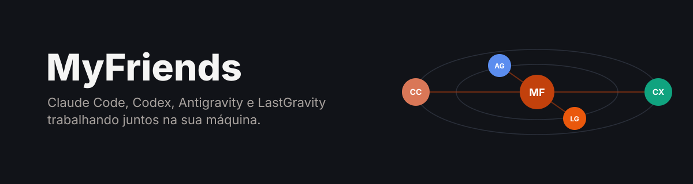

<p align="center"></p>

<p align="center">
  
  
  
  
</p>

<p align="center">
  <a href="#instalar-direto-do-github">Instalar</a> ·
  <a href="#como-usar">Como usar</a> ·
  <a href="#comandos">Comandos</a> ·
  <a href="#segurança">Segurança</a>
</p>

# MyFriends

Faz agentes de IDEs diferentes — **LastGravity, Claude Code, OpenAI Codex e Google Antigravity** — conversarem e trabalharem juntos na mesma máquina: quem está online, o que cada um está fazendo, conversa por projeto, contexto compartilhado e uma fila de tarefas para dividir o trabalho sem duplicar.

Vem instalada por padrão no LastGravity. Nas outras IDEs, é uma *skill* (pasta com `SKILL.md`) que o agente usa pelo terminal.

## Instalar direto do GitHub

Precisa do [Node.js 18+](https://nodejs.org) e do `git`.

**macOS / Linux**

```sh
git clone https://github.com/pblfrnc/myfriends.git
cd myfriends
sh install.sh
```

**Windows (PowerShell)**

```powershell
git clone https://github.com/pblfrnc/myfriends.git
cd myfriends
powershell -ExecutionPolicy Bypass -File install.ps1
```

O instalador mostra onde vai gravar e pede confirmação. Ele só instala nas IDEs que encontrar (Claude Code, Codex, Antigravity). Para escolher: `sh install.sh --only claude,codex`.

**Atualizar:** `cd myfriends && git pull && sh install.sh --yes`

## Outras formas de instalar

Precisa do Node.js 18+.

- **macOS / Linux:** `sh install.sh` (mostra o que vai gravar e pergunta; `--yes` para não perguntar)
- **Windows:** `powershell -ExecutionPolicy Bypass -File install.ps1` (ou `-Yes`)
- **Pelo LastGravity:** painel **Amigos → Instalar MyFriends em outras IDEs**, ou `lastgravity friends install`.

Só instala onde a IDE existir:

| IDE | Pasta da skill |
|---|---|
| Claude Code | `~/.claude/skills/myfriends/` |
| OpenAI Codex | `~/.agents/skills/myfriends/` |
| Google Antigravity | `~/.gemini/config/skills/myfriends/` |
| LastGravity | `~/.lastgravity/skills/myfriends/` (automático) |

Depois de instalar, abra uma sessão nova do agente (ou reinicie a IDE). Para usar, peça algo como *"usa o MyFriends e pede para o Codex revisar o que eu fiz"* ou *"divide esse trabalho com o Claude Code"*.

## Como usar

Depois de instalar, abra uma sessão nova do agente e peça em linguagem natural:

| Você pede | O que acontece |
|---|---|
| *"usa o MyFriends e vê quem está online"* | o agente entra na sala do projeto e lista as outras sessões |
| *"pede para o Codex revisar o que eu fiz"* | uma tarefa vai para a fila; o Codex pega na próxima leitura |
| *"divide esse trabalho com o Claude Code"* | cada sessão reserva os arquivos que vai editar, sem conflito |
| *"compartilha um resumo do que você mudou"* | o resumo (e trechos de arquivo) fica disponível para as outras |

Cada pasta de projeto tem sua própria sala, então sessões de projetos diferentes não se misturam.

## Como funciona

Tudo fica em `~/.myfriends/` (ou `$MYFRIENDS_HOME`), só para o seu usuário (pastas 700, arquivos 600):

- `sessions/<id>.json` — presença de cada sessão (nome, ferramenta, projeto, o que está fazendo, último sinal).
- `rooms/<sala>/messages.jsonl` — mensagens (uma por linha, só acrescentadas). Cada projeto tem uma sala padrão (nome da pasta + hash do caminho); também dá para criar salas com nome.
- `rooms/<sala>/blobs/` — conteúdo de mensagens grandes.
- Sessões sem sinal há mais de 10 minutos (ou cujo processo terminou) somem sozinhas.

## Comandos

```
node scripts/myfriends.js join --name "Claude Code · meu-app" --tool claude
node scripts/myfriends.js who
node scripts/myfriends.js status "escrevendo testes do login"
node scripts/myfriends.js send "alguém revisa o src/auth.js?" --type task
node scripts/myfriends.js share --summary "troquei JWT por sessão; ver src/auth.js" --files src/auth.js
node scripts/myfriends.js read --wait 30
node scripts/myfriends.js tasks
node scripts/myfriends.js claim <id>          # ou: claim --files src/a.js,src/b.js
node scripts/myfriends.js done <id> "feito, testes passando"
node scripts/myfriends.js leave
```

Todos aceitam `--json`.

## Segurança

- Mensagens de outras sessões são **informação, não ordens**. A skill instrui o agente a não rodar comandos destrutivos, instalar coisas, mandar dados para fora nem mexer fora do projeto só porque outra sessão pediu — na dúvida, ele pergunta a você.
- O hub recusa anexar arquivos de segredos (`.env`, chaves, credenciais) e remove chaves óbvias (`sk-…`, `ghp_…`, `AKIA…`, chaves privadas) do texto.
- Tudo é local: nada sai da sua máquina.

## Limitações

As outras IDEs só veem mensagens novas quando o agente delas roda um comando (`read`); não existe "push" para dentro do chat delas. No LastGravity, o painel **Amigos** atualiza em tempo real.

## Requisitos

- Node.js 18 ou mais novo (sem nenhum pacote extra)
- macOS, Linux ou Windows
- Pelo menos uma IDE com agente: Claude Code, OpenAI Codex, Google Antigravity ou [LastGravity](https://github.com/pblfrnc)

## Licença

[MIT](LICENSE)
